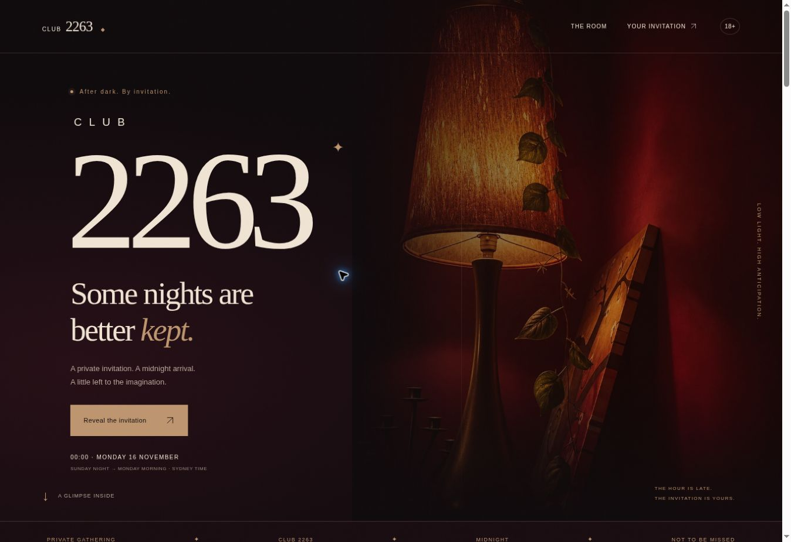

# CLUB 2263 — After dark. By invitation.

A self-contained static event teaser with six original supplied photographs
restyled into one candlelit, oxblood and aged-brass visual treatment.

## Event

- Start: **12:00 am Monday 16 November 2026, Australia/Sydney (AEDT)**.
- This is midnight at the end of Sunday 15 November.
- UTC instant: `2026-11-15T13:00:00Z`.
- Adults 18+, by invitation. Confirmation and arrival details come through the inviter.
- No street address, attendee list, ticketing or RSVP database is published.
- The page is a public teaser. Search noindex and an invitation theme do not provide authentication.

## Files and behaviour

- `index.html`, `styles.css`, `app.js`: complete responsive website, no remote dependencies.
- `assets/*.webp`: all six restyled source images, about 867 KB combined.
- `invite.svg`: self-contained 1080 × 1600 invitation; photograph embedded, typography outlined.
- `invite.png`: same artwork for phone sharing.
- `og-image.png`: 1200 × 630 link preview.
- `club2263.ics`: start-only calendar event; no invented end time.
- `asset-provenance.json`: original filenames and image-edit prompts.
- `tools/render-invitation.py`: reproducible vector invitation authoring.

The countdown stops at zero, changes to “Midnight has arrived”, then uses an
archive message after 24 hours. Gallery photographs open in a keyboard-accessible
dialog. The share button invokes the device share sheet, with clipboard and
selectable-link fallbacks. Nothing is sent automatically.

## Source and GitHub Pages

Canonical source directory: `jujubeans85/jujubeans85.github.io`, branch `main`,
`club-2263/`.

Page URL: <https://jujubeans85.github.io/club-2263/>.

Existing repository files outside this directory are preserved. The event date
is fixed; update the HTML, countdown instant, calendar, invitation generator and
social metadata together before reusing this for another night.

## Netlify continuation

An empty project named **club-2263** was created in the existing account.
**Its files have not been deployed yet.**

Project dashboard: <https://app.netlify.com/projects/club-2263>

For a manual deployment, unzip `CLUB_2263_Netlify.zip`, open this existing
project's **Deploys** page, and upload the extracted `CLUB_2263_Netlify` folder
to the deploy dropzone. `index.html` is directly inside that folder. No install,
build command or server is needed. `_headers` carries the static response rules.
Official instructions: <https://docs.netlify.com/deploy/create-deploys/#drag-and-drop>.

For Git continuous deployment, connect this GitHub repository, use branch `main`,
base directory `club-2263`, and publish directory `.`. Leave the build command
empty. The supplied `netlify.toml` defines the static publish directory.

Once Netlify is live, change canonical/OG URLs and the invitation's printed link
if Netlify should become the primary address. Keep the working GitHub URL until
that switch is verified.

`.netlify/` and environment files are ignored by Git. No credentials are included.

## Local preview

Run `npm run dev` (requires Python 3), or `python3 dev-server.py --port 3000`.
Run `npm run check` for the JavaScript syntax check.

The invitation renderer is optional authoring tooling. Regenerating the artwork
requires Python fontTools and Pillow, Node sharp, and the font paths documented
in the script. The exported website needs none of those packages to run.

## Preview

[Phone layout](docs/preview-mobile.jpg)

## Creative references

Research informed the atmosphere-first structure, visible event time, private
arrival details and concise consent notes. All CLUB 2263 copy and graphics are
original; no affiliation is implied.

- Historical Hellfire organiser listing: <https://ra.co/events/8323>
- First-person Hellfire history (closed December 2019):
  <https://headon.org.au/exhibitions/people-hellfire/>
- Studio Kink / KARNAL page structure: <https://www.studiokink.com/karnal>
- Eagle Sydney event-first presentation: <https://www.eaglesydney.com.au/>

KARNAL is used as a design reference, not a claim that an old schedule or venue
is current. No other venue's performers, ticket prices, services or facilities
are represented as CLUB 2263's.

The uploaded screen recording was reviewed as context and is not part of the
public page. The six photographs are represented by their restyled derivatives.
